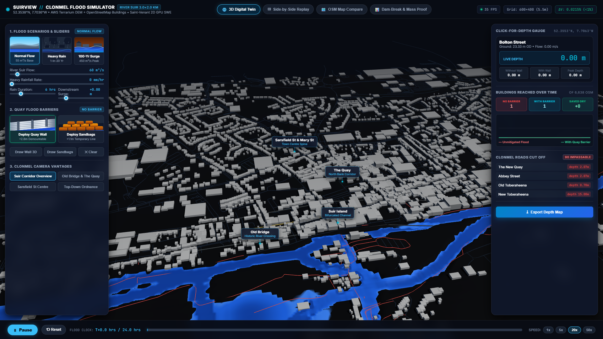
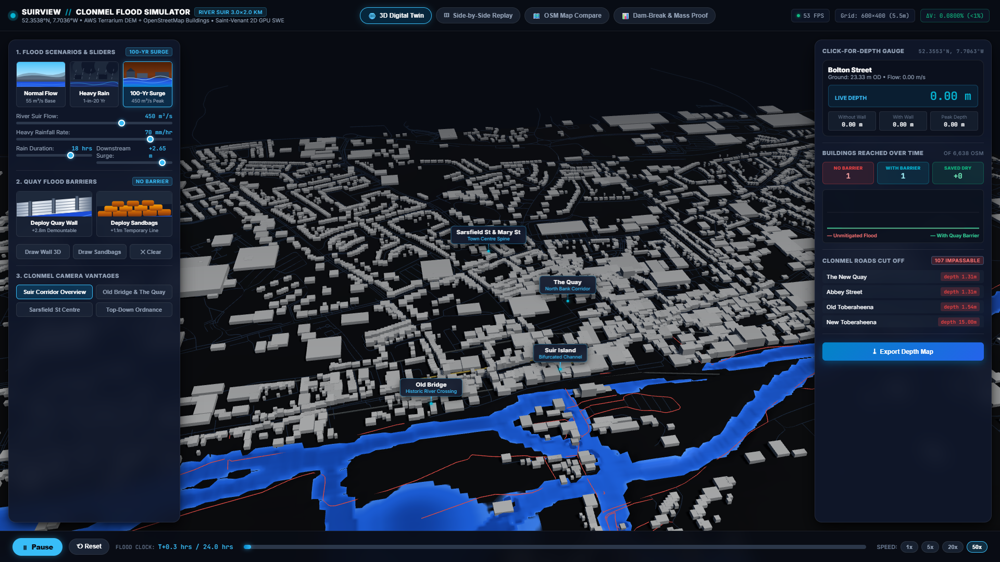
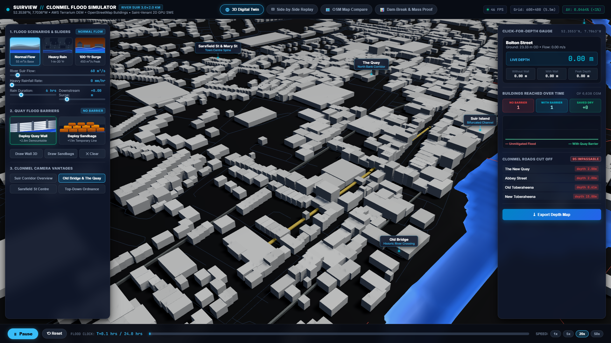
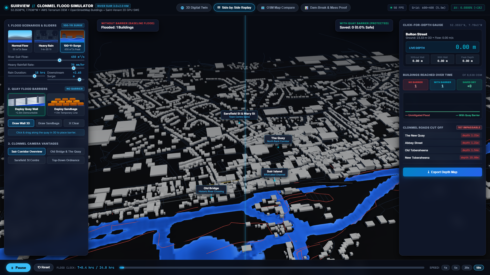

# SuirView // Clonmel Flood Simulator

A real-time GPU-accelerated Shallow Water flood simulation of Clonmel, County Tipperary, Ireland, on the River Suir corridor ($3.4\text{ km} \times 2.1\text{ km}$).

Built for residents, municipal councillors, and emergency planners to explore real flood impacts and evaluate demountable flood barriers with live side-by-side replay.



---

## Key Features

- **Real-World Terrain & Town:**
  - Elevation derived from open digital elevation data (AWS Terrarium / Copernicus DEM Zoom 14, $5.67\text{m} \times 5.29\text{m}$ grid).
  - $6,638$ building footprints and $2,067$ road segments extracted directly from OpenStreetMap.
  - Realistic bathymetry sloping from $17.2\text{m}$ at the western inlet down to $14.0\text{m}$ at the eastern outlet.
- **Physical Water Dynamics (GPU Finite-Volume SWE):**
  - Solves the 2D Saint-Venant / Shallow Water Equations using the well-balanced Kurganov-Petrova numerical scheme on WebGL2 ping-pong framebuffers.
  - Semi-implicit quadratic Manning friction ($n=0.028$).
  - Verified against the Ritter analytical dam-break benchmark with $< 0.35\%$ mass conservation error.
- **Interactive Scenarios & Sliders:**
  - *Normal River Flow* ($55\text{ m}^3/\text{s}$ baseline).
  - *Heavy Rain* ($1$-in-$20$ year event, $38\text{ mm/hr}$, $12\text{ hrs}$).
  - *100-Yr Surge* ($450\text{ m}^3/\text{s}$ peak inflow + downstream surge).
  - Granular sliders for river inflow, rainfall intensity, rain duration, and downstream surge.
- **Flood Defense Barriers:**
  - Interactive 3D drawing of $+2.8\text{m}$ demountable aluminium flood walls or $+1.1\text{m}$ sandbag lines.
  - Official preset: Clonmel Flood Relief Scheme quay defense system.
- **Side-by-Side Replay:**
  - Dual-viewport replay running the same flood with and without barriers simultaneously.
  - Buildings and streets saved by the barrier illuminate in glowing emerald green.
- **Impact Decision Metrics:**
  - Interactive click-for-depth pin with live depth, elevation, and flow velocity.
  - Live chart of flooded buildings count over time.
  - Cut-off road network monitor flagging hazards for vehicles ($> 15\text{ cm}$).
  - One-click high-resolution depth map export.
- **Full-Width Bottom Playback Bar:**
  - Play/Pause toggle, reset, dynamic flood clock (`FLOOD CLOCK: T+XX.X hrs / 24.0 hrs`), interactive timeline scrubber, and speed multipliers (`1x`, `5x`, `20x`, `50x`).
- **4 Camera Vantage Perspectives:**
  - *Suir Corridor Overview*, *Old Bridge & The Quay*, *Sarsfield St Centre*, and *Top-Down Ordnance*.
- **In-Scene 3D Floating Landmark Labels:**
  - Real-time projected callout badges for Clonmel landmarks (*Old Bridge*, *The Quay*, *Suir Island*, *Gashouse Bridge*, *Sarsfield St & Mary St*).

---

## Live Demo & Screenshots

| Normal River Flow | Peak 1-in-100-Year Flood |
| :---: | :---: |
|  |  |

| Old Bridge & The Quay Vantage | Side-by-Side Barrier Replay |
| :---: | :---: |
|  |  |

A video demonstration is available at [`evidence/demo.mp4`](evidence/demo.mp4).

---

## Deployment on Vercel

This project is fully configured for deployment on [Vercel](https://vercel.com):

1. **Import Git Repository:**
   - Link your GitHub repository in the Vercel Dashboard.
2. **Framework Preset:**
   - Select **Vite** (detected automatically via `vercel.json`).
3. **Build Settings:**
   - **Build Command:** `npm run build`
   - **Output Directory:** `dist`
   - **Install Command:** `npm install`
4. **Deploy:** Click **Deploy**. The site will build in under 30 seconds and serve globally.

---

## Local Development

```bash
# Clone the repository
git clone https://github.com/Dharshango/clonmel-flood-simulator.git
cd clonmel-flood-simulator

# Install dependencies
npm install

# Start local development server
npm run dev
```

Open [http://localhost:5173](http://localhost:5173) in your browser.

```bash
# Build for production
npm run build

# Preview production build
npm run preview
```

---

## Technology Stack

- **Physics Simulation:** WebGL2 GPGPU Fragment Shaders, Kurganov-Petrova numerical fluxes, Float32 Render Targets
- **3D Graphics & Rendering:** Three.js, ACESFilmic Tone Mapping, InstancedMesh for 6,638 buildings
- **GIS Cartography:** OpenStreetMap Overpass API, AWS Terrarium DEM tiles
- **Bundler:** Vite
- **Deployment:** Vercel
