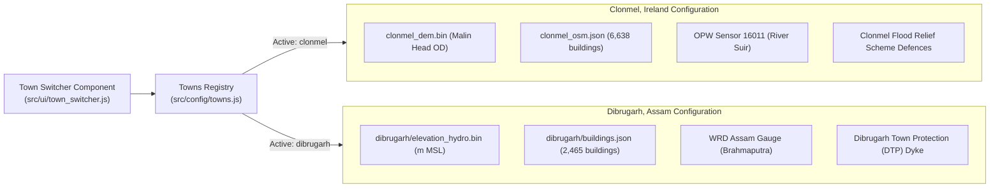

# HydroVerse Architecture & Technical Specification

**System:** HydroVerse 2D Hydrodynamic Simulation & Multi-Town Decision Support Platform  
**Version:** 1.0.0 Production  
**Primary Standards:** 2D Shallow Water Equations (SWE), WebGL2 GPGPU, Three.js Rendering  

---

## 1. Architectural Overview

HydroVerse combines high-performance GPU-accelerated numerical fluid dynamics with interactive 3D geospatial rendering and municipal flood decision-support tools. The application runs entirely client-side inside the browser using WebGL2 and Three.js, achieving 60 FPS real-time simulation speeds without requiring expensive backend server compute.

```mermaid
graph TD
    subgraph BrowserClient ["Browser Client Execution Space"]
        UI["UI Layer (Vanilla ES6 Modular Components)<br>Workspaces, TopNav, Timeline, Controls"]
        STATE["Global State Manager (src/ui/state.js)<br>Active Town, Scenarios, HUD, Probes, Playback"]
        
        subgraph ComputeEngine ["Numerical Simulation Subsystem (GPU)"]
            SWE["SWESolver (src/simulation/swe_solver.js)"]
            SHADERS["SWE Shaders (Kurganov-Petrova, Bed Update, Friction)"]
            PING_PONG["WebGL2 Ping-Pong Framebuffer Architecture<br>Texture A <--> Texture B (R32F/RGBA32F)"]
            SWE --> SHADERS
            SHADERS --> PING_PONG
        end

        subgraph RenderEngine ["3D Geospatial Visualization Subsystem (Three.js)"]
            SCENE["Three.js Scene Manager (src/main.js)"]
            TERRAIN["TerrainMesh & Elevation Shaders"]
            WATER["WaterSurface & Depth Tint Shaders"]
            BUILDINGS["Extruded 3D Building Geometry & Dynamic Color Tint"]
            ROADS["Vector Road Network Mesh"]
            DEFENCES["Engineered Flood Wall & Barrier Meshes"]
            
            SCENE --> TERRAIN
            SCENE --> WATER
            SCENE --> BUILDINGS
            SCENE --> ROADS
            SCENE --> DEFENCES
        end

        subgraph DecisionSuite ["10 Operational Decision Workspaces"]
            W_OVERVIEW["1. Overview / Hero"]
            W_MAP["2. Live Map & Overlays"]
            W_TIME["3. Time Machine"]
            W_INTERV["4. Intervention Lab"]
            W_INFRA["5. Infrastructure Impact"]
            W_EVID["6. Community Evidence"]
            W_EXER["7. Command Exercise"]
            W_SCI["8. Science & Validation"]
            W_FCST["9. Forecast Ops"]
            W_DEF["10. Defence Monitor"]
            W_EXP["11. Explain Forecast"]
        end
    end

    UI --> STATE
    STATE --> SWE
    STATE --> SCENE
    PING_PONG -->|Water Depth & Velocity Fields| WATER
    PING_PONG -->|Depth Sampling at Centroids| BUILDINGS
    STATE --> DecisionSuite
```

---

## 2. Governing Hydrodynamic Equations & Numerical Discretization

The simulation engine solves the **2D Non-Conservative Shallow Water Equations (Saint-Venant Equations)** with bottom topography and quadratic friction:

$$\frac{\partial \mathbf{U}}{\partial t} + \frac{\partial \mathbf{F}(\mathbf{U})}{\partial x} + \frac{\partial \mathbf{G}(\mathbf{U})}{\partial y} = \mathbf{S}_b(\mathbf{U}) + \mathbf{S}_f(\mathbf{U}) + \mathbf{S}_r$$

Where:
- $\mathbf{U} = [h, hu, hv]^T$: Conserved state vector (water depth $h$, discharge components $hu$ and $hv$).
- $\mathbf{F}(\mathbf{U}) = [hu, hu^2 + \frac{1}{2}gh^2, huv]^T$: Hyperbolic flux vector in the $x$-direction.
- $\mathbf{G}(\mathbf{U}) = [hv, huv, hv^2 + \frac{1}{2}gh^2]^T$: Hyperbolic flux vector in the $y$-direction.
- $\mathbf{S}_b = [0, -gh\frac{\partial z_b}{\partial x}, -gh\frac{\partial z_b}{\partial y}]^T$: Bed slope source terms ($z_b$ is ground surface elevation).
- $\mathbf{S}_f = [0, -C_f u \sqrt{u^2 + v^2}, -C_f v \sqrt{u^2 + v^2}]^T$: Manning bed friction source terms, with $C_f = g n^2 / h^{1/3}$.
- $\mathbf{S}_r = [R, 0, 0]^T$: Direct rainfall rate source term.

### 2.1 Kurganov-Petrova Central-Upwind Scheme

To capture flood wave fronts without artificial oscillations or expensive exact Riemann solvers, we implement the second-order **Kurganov-Petrova (KP) scheme**:

$$\mathbf{F}_{i+1/2} = \frac{a_{i+1/2}^+ \mathbf{F}(\mathbf{U}_{i+1/2}^L) - a_{i+1/2}^- \mathbf{F}(\mathbf{U}_{i+1/2}^R)}{a_{i+1/2}^+ - a_{i+1/2}^-} + \frac{a_{i+1/2}^+ a_{i+1/2}^-}{a_{i+1/2}^+ - a_{i+1/2}^-} \left( \mathbf{U}_{i+1/2}^R - \mathbf{U}_{i+1/2}^L \right)$$

Where $a^+$ and $a^-$ are one-sided local wave propagation speeds:
$$a_{i+1/2}^+ = \max\left( u_{i+1/2}^R + \sqrt{g h_{i+1/2}^R},\, u_{i+1/2}^L + \sqrt{g h_{i+1/2}^L},\, 0 \right)$$
$$a_{i+1/2}^- = \min\left( u_{i+1/2}^R - \sqrt{g h_{i+1/2}^R},\, u_{i+1/2}^L - \sqrt{g h_{i+1/2}^L},\, 0 \right)$$

Cell-interface reconstruction uses the **Minmod slope limiter** to preserve Total Variation Diminishing (TVD) stability:
$$\text{minmod}(a, b) = \begin{cases} \min(a, b) & \text{if } a > 0, b > 0 \\ \max(a, b) & \text{if } a < 0, b < 0 \\ 0 & \text{otherwise} \end{cases}$$

### 2.2 Well-Balanced Hydrostatic Reconstruction

To prevent spurious currents over steep topography at rest ($u=v=0, \eta = h + z_b = \text{const}$), the solver uses the Audusse well-balanced hydrostatic reconstruction:
$$z_{b, i+1/2} = \max(z_{b, i}, z_{b, i+1})$$
$$h_{i+1/2}^L = \max(0, \eta_i^L - z_{b, i+1/2}), \quad h_{i+1/2}^R = \max(0, \eta_{i+1}^R - z_{b, i+1/2})$$

---

## 3. WebGL2 GPGPU Implementation

The solver is implemented in WebGL2 utilizing double-buffered 32-bit floating-point textures:

1. **State Texture Format**: `RGBA32F` (Red = $h$, Green = $hu$, Blue = $hv$, Alpha = $h_{\text{max}}$).
2. **Terrain Texture Format**: `R32F` (Red = $z_b$ ground elevation in meters).
3. **Execution Loop**:
   - Step 1: Flux computation pass (computes $x$ and $y$ numerical fluxes via Kurganov-Petrova).
   - Step 2: Conservation update pass (advances state in time using Strong Stability Preserving Runge-Kutta 2nd Order).
   - Step 3: Semi-implicit friction and boundary condition pass (applies Manning drag and Dirichlet/Neumann boundaries).
   - Step 4: Ping-Pong swap (swaps read and write framebuffers for the next sub-step).

---

## 4. Multi-Town Geospatial Isolation Protocol

HydroVerse maintains strict runtime and architectural separation between its two supported geographic locations:

- **Clonmel**: Focused on fluvial overtopping of the River Suir through urban bridges, with historic flood baselines (Storm Frank 2015). Datum: Malin Head Ordnance Datum (OD).
- **Dibrugarh**: Focused on monsoon riverine surge of the Brahmaputra River, embankment stability of the 9.5 km DTP Dyke, and monsoon cloudburst waterlogging. Datum: Meters Above Mean Sea Level (m MSL).

---

## 5. UI & Decision Support Workspaces

The application exposes 10 specialized operational workspaces:
1. **Overview**: High-impact introduction, interactive background contours, quick navigation.
2. **Live Map**: Dual 2D/3D viewport, orbital camera navigation, 4 analytical overlays.
3. **Time Machine**: Timeline playback, scrub bar, historical replay vs real-time simulation.
4. **Intervention Lab**: Interactive barrier placement tool, real-time elevation update, side-by-side comparison.
5. **Infrastructure Impact**: Monitored critical infrastructure facilities, depth thresholds, and live status badges.
6. **Community Evidence**: Georeferenced citizen flood observations with verified photographic evidence.
7. **Command Exercise**: Timed incident commander simulation with dynamic breach injects.
8. **Science & Validation**: Interactive analytical benchmark runner with real-time error plots.
9. **Forecast Ops**: Upstream hydrographs, river gauge status, sensor latency alerts.
10. **Defence Monitor**: Asset inventory, real-time freeboard analyzer, and overtopping warnings.
11. **Explain Forecast**: 5-part natural language causal decomposition of flood drivers.
