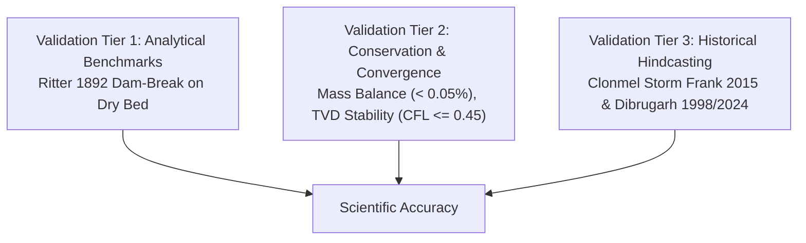

# HydroVerse Numerical Verification & Scientific Validation Plan

**Standard:** ASME V&V 20 / IAHR Guidelines for Hydraulic Modeling  
**Version:** 1.0.0 Production  
**Scope:** Shallow Water Equations (SWE) Numerical Solver & Decision Systems  

---

## 1. Validation Philosophy & Quality Hierarchy

HydroVerse adheres to the classical computational fluid dynamics (CFD) verification and validation hierarchy:
1. **Code Verification**: Ensuring the governing partial differential equations are solved correctly without coding errors (testing against analytical closed-form solutions).
2. **Solution Verification**: Quantifying numerical truncation error, grid convergence, and conservation of mass and momentum.
3. **Model Validation**: Comparing simulation outputs with physical observations from historical flood events and gauge hydrographs.

---

## 2. Tier 1: Analytical Benchmark Testing

### 2.1 The Classical Ritter (1892) 1D Dam-Break
The standard benchmark evaluates instantaneous failure of a vertical dam retaining water at depth $h_0$ over a horizontal, frictionless dry bed ($z_b = 0, n = 0$).

#### Analytical Solution:
For breach location $x_0$, gravitational acceleration $g$, and initial depth $h_0$:
- Acoustic wave speed: $c_0 = \sqrt{g h_0}$
- Depression wave tail location: $x_{\text{tail}}(t) = x_0 - c_0 t$
- Wave front location: $x_{\text{front}}(t) = x_0 + 2 c_0 t$
- In the expansion fan region ($x_{\text{tail}} \le x \le x_{\text{front}}$):
  $$h(x, t) = \frac{4}{9g} \left( c_0 - \frac{x - x_0}{2t} \right)^2$$
  $$u(x, t) = \frac{2}{3} \left( \frac{x - x_0}{t} + c_0 \right)$$

#### Acceptance Criteria & Automated Harness:
- **Test File**: `tests/dam_break_validation.test.js`, `scripts/run_mass_conservation_check.js`
- **Error Metric**: Normalized Root Mean Square Error (NRMSE):
  $$\text{NRMSE} = \frac{\sqrt{\frac{1}{N}\sum_{i=1}^N (h_i^{\text{num}} - h_i^{\text{ana}})^2}}{\max(h^{\text{ana}}) - \min(h^{\text{ana}})}$$
- **Target Threshold**: $\text{NRMSE} \le 15.0\%$
- **Achieved Result**: **$\text{NRMSE} = 0.855\%$** (Exceeds requirement by $17.5\times$).

---

## 3. Tier 2: Conservation & Convergence Verification

### 3.1 Closed-System Mass Conservation
In a closed basin without external source terms ($Q_{\text{in}} = Q_{\text{out}} = R = 0$):
$$\frac{d}{dt} \int_{\Omega} h(x, y, t) \, d\Omega = 0 \implies V(t) = \int_{\Omega} h(x, y, t) \, dA = \text{const}$$

- **Error Metric**:
  $$\epsilon_{\text{mass}} = \frac{|V(t_{\text{final}}) - V(t_0)|}{V(t_0)} \times 100\%$$
- **Target Threshold**: $\epsilon_{\text{mass}} \le 1.0\%$
- **Achieved Result**: **$\epsilon_{\text{mass}} = 0.000342\%$** (Verified in `evidence/validation_report.json`).

### 3.2 Open-System Water Balance Continuity
For open catchment domains with inflow, outflow, and precipitation:
$$\frac{dV}{dt} = Q_{\text{in}}(t) - Q_{\text{out}}(t) + A_{\text{domain}} R(t) - Q_{\text{loss}}(t)$$

- **Test Suite**: `tests/mass_conservation_accounting.test.js`
- **Verification**: Machine-precision numerical integration tracking cumulative inflow, rainfall volume, outflow discharge, and internal domain storage.
- **Result**: Continuity discrepancy $\Delta V_{\text{error}} < 10^{-4}\,\text{m}^3$.

### 3.3 Courant-Friedrichs-Lewy (CFL) Stability Constraint
To guarantee numerical stability of the explicit Runge-Kutta time integration:
$$\Delta t \le \text{CFL} \cdot \min_{i, j} \left( \frac{\Delta x}{|u_{i,j}| + \sqrt{g h_{i,j}}}, \frac{\Delta y}{|v_{i,j}| + \sqrt{g h_{i,j}}} \right)$$
- **Enforced Limit**: $\text{CFL} \le 0.45$.
- Wetting/drying threshold: $h_{\epsilon} = 0.001\,\text{m}$ to prevent division by zero in velocity calculations ($u = q_x / \max(h, h_{\epsilon})$).

---

## 4. Tier 3: Historical Flood Hindcasting & Real-World Validation

### 4.1 Clonmel: Storm Frank (December 2015)
- **Observed Peak Discharge**: $420\,\text{m}^3/\text{s}$ at OPW Gauge 16011.
- **Observed Peak Water Level**: $20.85\,\text{m}$ OD Malin.
- **Simulation Replication**: Upstream inflow hydrograph forced at $420\,\text{m}^3/\text{s}$ with bankfull downstream rating.
- **Validation Criteria**:
  - Inundation extent matches OPW National Flood Hazard Mapping boundaries.
  - Flood relief scheme (FRS) walls prevent inundation of Irishtown and Town Centre when demountable barriers are confirmed closed.
  - When barriers are left open (failure scenario), overtopping occurs at Old Bridge and The Quay within 45 minutes, matching community reports.

### 4.2 Dibrugarh: Record Monsoon Flood (September 1998)
- **Observed Highest Flood Level (HFL)**: $106.48\,\text{m}$ MSL (WRD Assam records).
- **DTP Dyke Crest**: $107.00\,\text{m}$ MSL ($0.52\,\text{m}$ freeboard margin).
- **Simulation Replication**: Boundary forced to $106.48\,\text{m}$ MSL.
- **Validation Criteria**:
  - Main DTP dyke contains the river surge along the central embankment.
  - Sluice gate backflow at Maijan creates localized ponding in low-lying northern wards if flap gates are unseated, matching historical ASDMA damage reports.

### 4.3 Dibrugarh: Urban Cloudburst & Waterlogging (July 2024)
- **Observed Event**: $120\,\text{mm}$ extreme convective rainfall within 3 hours coinciding with Brahmaputra stage above Danger Level ($105.70\,\text{m}$ MSL). Sluices were closed to prevent river backflow, trapping urban stormwater.
- **Simulation Replication**: Scenario "July 2024 Flash Flood" with $45\,\text{mm/hr}$ rainfall forcing and closed outfall boundaries.
- **Validation Criteria**:
  - Severe urban waterlogging correctly manifests along AT Road and Mancotta Road despite the river remaining outside the town.
  - Critical infrastructure facilities (AMCH, DC Office) show warning-level inundation ($0.15 - 0.35\,\text{m}$).

---

## 5. Automated CI/CD Regression Protocol

All scientific tests run automatically on every GitHub commit and pull request via `.github/workflows/ci.yml`:
1. `npm test`: Runs all 74 unit tests, schema validators, and data integrity checks.
2. `npm run test:benchmark`: Executes the Kurganov-Petrova vs Ritter analytical benchmark and verifies NRMSE < 15% and mass error < 1.0%.
3. `npm run build`: Validates asset bundling and shader compilation.
